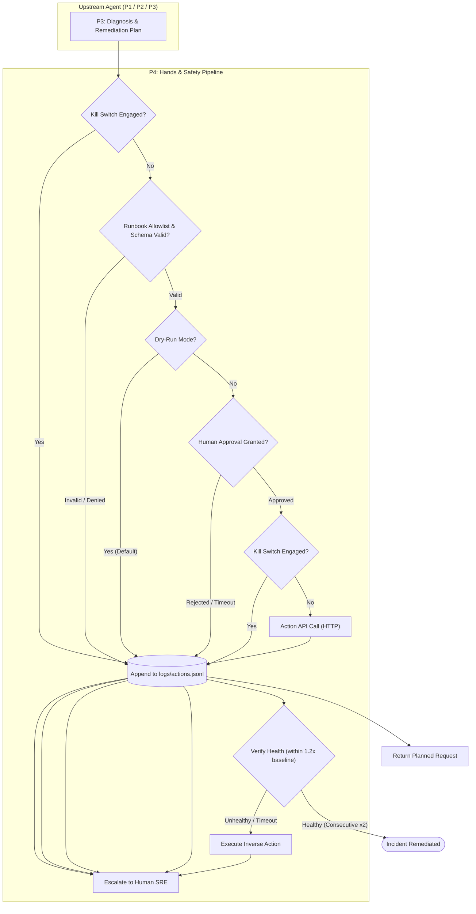

# Implementation Guide: P4 Hands & Safety

> **Module:** AI On-Call Engineer — Actuation, Guardrails & Human-in-the-Loop Safety (P4)  
> **Repository Path:** `P4_Hands_and_Safety`  
> **Core Philosophy:** *Fail Closed, Safe by Default, Humans Retain Ultimate Authority, Escalation Beats a Confident Wrong Fix.*

---

## 1. Executive Summary

The **`P4_Hands_and_Safety`** package represents the **"Hands"** (actuation engine) and **"Safety Guardrails"** of an autonomous AI incident remediation agent. While upstream modules identify incidents (P1: Loop Orchestration), observe metrics (P2: Telemetry / RED metrics), and diagnose root causes (P3: Diagnosis & Reasoning), **P4 is the only component authorized to interact with and mutate target infrastructure**.

To eliminate the risks of autonomous hallucination, destructive commands, or runaway loops, P4 implements **multi-layered defense-in-depth**:
- **Zero Arbitrary Execution:** Only actions explicitly defined in an immutable runbook allowlist (`runbook.yaml`) are recognized.
- **Fail-Closed Validation:** Unrecognized parameters, malformed values, or denylisted targets are rejected before any network traffic is generated.
- **Human-in-the-Loop Approval:** No mutating infrastructure call is ever sent without explicit, cryptographic-like confirmation from a human engineer (CLI typed `"yes"` or Streamlit UI approval).
- **Dual-Phase Kill Switch:** Evaluated before every step, before seeking approval, and *again* immediately before socket transmission to prevent stale approvals from executing during an emergency halt.
- **Automated Verification & Rollback:** Remediations are continuously verified against baseline health metrics. If health is not restored, the system automatically prompts for and triggers inverse rollback actions or escalates to human operators.
- **Redacted Audit Trail:** Every action attempt (whether blocked, dry-run, executed, or failed) is written to an append-only JSONL log with auth tokens redacted.

---

## 2. Directory & Component Structure

```
P4_Hands_and_Safety/
│
├── P4agent/
│   ├── __init__.py               # Package marker exposing `selftest_all()`
│   └── act/
│       ├── __init__.py           # Subpackage entrypoint for P4 actuation & safety
│       ├── killswitch.py         # Emergency stop mechanism (file & env var checks)
│       ├── runbook.yaml          # Declarative allowlist of valid actions & schemas
│       ├── approval.py           # Human approval gates (CLI prompt & UI file-handshake)
│       ├── action_api.py         # Guarded ActionClient, request builder, transport & audit logger
│       ├── verify.py             # Telemetry-based health verification & rollback engine
│       └── requirements.txt      # Runtime dependencies (pyyaml, streamlit)
│
├── ui/
│   └── app.py                    # Streamlit operator dashboard for approvals and emergency halt
│
└── implementation.md             # This architecture and implementation documentation
```

---

## 3. Core Architecture & Module Details



---

### 3.1. `P4agent/act/killswitch.py` — Emergency Halt Switch

The kill switch guarantees that human operators can instantaneously freeze the agent at any point in its execution lifecycle.

- **Trigger Mechanisms:**
  1. **File-based:** Presence of a `./KILL` file in the repo root (customizable via `AGENT_KILL_FILE` environment variable).
  2. **Environment variable:** `AGENT_KILL=1`.
- **Key Functions:**
  - `is_engaged(kill_file=None) -> bool`: Non-raising boolean status check.
  - `check(kill_file=None) -> None`: Raises `KillSwitchEngaged(reason)` if tripped. Intended for agent loop headers.
  - `engage(kill_file=None, why="manual") -> Path`: Atomically creates the `KILL` file via a temporary file + `os.replace` to prevent race conditions.
  - `clear(kill_file=None) -> None`: Removes the `KILL` file to allow operations to resume.
- **Safety Invariant:** Evaluated both *before* seeking approval and *again immediately prior* to dispatching network payloads.

---

### 3.2. `P4agent/act/runbook.yaml` — Declarative Allowlist

Acts as the single source of truth for permissible operations. Any command or API endpoint not defined in this file is rejected unconditionally.

- **Denylisted Services (`denylist_services`):**  
  `[flagd, flagd-ui]` — Services explicitly forbidden from being touched under any circumstances to prevent flag leakage or competition disqualification.
- **Allowlisted Actions:**
  1. `restart_service`:
     - Low risk.
     - Parameters: `service` (regex pattern: `[a-z0-9][a-z0-9_-]*`).
     - Preconditions: `service_not_denied`.
     - Inverse: `null` (restarts cannot be rolled back; failed restarts immediately escalate).
  2. `toggle_flag`:
     - Medium risk. Used to remedy fault flags or revert them.
     - Parameters: `flag` (string), `enabled` (boolean).
     - Inverse: `toggle_flag` with `enabled: "!$enabled"` (boolean negation).
  3. `throttle_loadgen`:
     - Low risk. Throttles simulated traffic during high-load incidents.
     - Parameters: `users` (int: 0–5000), `previous_users` (int: 0–5000).
     - Inverse: `throttle_loadgen` with `users: "$previous_users"` and `previous_users: "$users"`.
  4. `scale_service`:
     - Medium risk. Replicas adjustment.
     - Parameters: `service` (string), `replicas` (int: 1–10), `previous_replicas` (int: 1–10).
     - Preconditions: `service_not_denied`.
     - Inverse: Restores `previous_replicas`.

---

### 3.3. `P4agent/act/approval.py` — Human Approval Gate

Guarantees that no state-mutating request reaches infrastructure without explicit human consent.

- **Data Structure (`Approval`):**
  - `approved: bool`, `by: str`, `ts: str`, `answer: str`, `reason: str`.
- **Approval Modalities:**
  1. **CLI Mode (`request_approval`):**
     - Renders an ASCII report with root cause, component, confidence score, evidence list, planned action, and dry-run HTTP payload.
     - Prompts for input: **Only the exact lowercase string `"yes"` approves.**
     - Anything else (`"y"`, `"YES"`, `"Yes"`, `"no"`, EOF, keyboard interrupt, or engaged kill switch) evaluates to `Approval(approved=False)`.
  2. **UI / Headless Mode (`file_approval`):**
     - Asynchronous file handshake designed for web or detached operations.
     - Atomically writes `pending/approval.json` containing proposal details and a unique proposal ID (`pid`).
     - Polls `pending/decision.json` for a matching `pid` and decision (`"approve"` vs `"reject"`).
     - Enforces a strict timeout (default: 600 seconds) and continuously monitors the kill switch during polling. Cleanly cleans up files on completion.

---

### 3.4. `P4agent/act/action_api.py` — Client & Safety Enforcement Pipeline

Wraps the target infrastructure's Action API inside strict guardrails.

- **Safe by Default:** `ActionClient(dry_run=True)` defaults to dry-run mode. Mutating actions require explicit `dry_run=False`.
- **6-Stage Execution Pipeline (`ActionClient.execute()`):**
  1. **Kill Switch Check:** If tripped, log as `blocked:kill_switch` and return.
  2. **Runbook & Precondition Validation:** Verifies action exists in allowlist, validates parameters against schema and regex patterns, checks preconditions (`service_not_denied`). Fails closed on any violation.
  3. **Dry-Run Inspection:** If `dry_run=True`, constructs the exact HTTP request, redacts sensitive headers, logs as `dry_run`, and returns without network I/O.
  4. **Approval Verification:** Verifies an `Approval` instance exists and has `approved=True`. Blocks if missing or unapproved.
  5. **Second Kill Switch Check:** Re-evaluates kill switch immediately before network transport.
  6. **Network Dispatch:** Executes via pluggable transport (`http_transport` using Python's standard `urllib`, or `FakeTransport` for testing) using Bearer token authentication.
- **Fail-Safe Response Contract:** Never throws unhandled runtime exceptions. Always returns:
  ```python
  {
      "ok": bool,          # True if HTTP 2xx or dry run succeeded
      "summary": str,       # Human-readable outcome message
      "data": dict,         # Detailed payload, sent status, HTTP status, and response body
      "source": str         # Method and target URL
  }
  ```
- **Audit Logging:** Appends every attempt to `logs/actions.jsonl` with timestamp, action, cleaned parameters, outcome, approver identity, dry-run flag, and sanitized response. Authorization tokens are strictly excluded from logs.

---

### 3.5. `P4agent/act/verify.py` — Health Verification & Automated Rollback

Executing an action is only half the job; P4 verifies that the system genuinely recovered and handles rollbacks if it did not.

- **Recovery Conditions (`is_recovered`):**
  - System health is sampled via a caller-provided function `health_fn() -> {"error_rate": float, "p95_ms": float}` (typically sourced from P2 telemetry RED metrics).
  - Recovery requires:
    $$\text{error\_rate} \le \max(\text{baseline\_error} \times 1.2, 0.005)$$
    $$\text{p95\_ms} \le \text{baseline\_p95} \times 1.2$$
  - **Streak Requirement (`CONSECUTIVE = 2`):** Must pass **two consecutive polls** to prevent transient dips or lucky samples from being misclassified as recovery.
- **Verification Loop & Automated Rollback (`verify_and_rollback`):**
  - Polls health every 15 seconds for up to 5 minutes.
  - Monitors the kill switch on every polling iteration.
  - **Outcome States:**
    | Status | Meaning | Escalation |
    | :--- | :--- | :--- |
    | `recovered` | Both metrics within $\le 1.2\times$ baseline for 2 consecutive polls | `escalate=False` |
    | `rolled_back` | Target did not recover; automatic inverse action executed with approval | `escalate=True` |
    | `rollback_rejected` | Target did not recover, but human rejected the rollback proposal | `escalate=True` |
    | `no_rollback` | Action has no inverse defined in `runbook.yaml` (e.g., `restart_service`) | `escalate=True` |
    | `rollback_failed` | Inverse action API returned HTTP error or network failure | `escalate=True` |
    | `killed` | Kill switch engaged during verification polling | `escalate=True` |
- **Safety Invariant:** *Everything except `recovered` sets `escalate=True`.* An explicit escalation to human operators is always preferred over an unverified, confident wrong fix.

---

### 3.6. `ui/app.py` — Operator Approval & Safety Dashboard

A Streamlit web interface designed for on-call engineers.

- **Dedicated Kill Switch Sidebar:**
  - Displays real-time status of the kill switch (ENGAGED vs. Not engaged).
  - One-click red `KILL - halt the agent now` button.
  - `Clear KILL (resume)` button to resume operations.
- **Pending Remediation Review:**
  - Reads `pending/approval.json`.
  - Visualizes incident metrics: Affected component, diagnostic confidence, root cause, and evidence list.
  - Shows proposed action, rationale, and exact JSON payload to be dispatched.
  - One-click `Approve` (disabled if kill switch is active) and `Reject` buttons writing to `pending/decision.json`.
- **Live Audit Trail:**
  - Displays the 10 most recent entries from `logs/actions.jsonl` in reverse chronological order.
- **Auto-Refresh:** Configurable 2-second polling loop.

---

## 4. Safety Matrix & Failure Modes

| Scenario | System Reaction | Resulting State |
| :--- | :--- | :--- |
| **Agent suggests `rm -rf /` or `drop_database`** | Fails runbook allowlist check. | Blocked (`not_allowlisted`). No network I/O. Logged. |
| **Agent tries to restart `flagd`** | Denylist check trips (`service_not_denied`). | Blocked (`invalid_params`). No network I/O. Logged. |
| **Human types `"y"`, `"YES"`, or `"yes please"`** | Strict match failed (`answer.strip() == "yes"`). | Rejected (`no_approval`). No action taken. |
| **Kill switch pressed while waiting for approval** | Check runs immediately before dispatch. | Blocked (`kill_switch`). Network call aborted. |
| **Prometheus/Telemetry crashes during verify** | `health_fn()` exception caught cleanly. | Treated as unhealthy; triggers rollback/escalate. |
| **Target service fails to recover after fix** | 5-minute timeout expires without 2 consecutive healthy polls. | Inverse action calculated; prompts approval; escalates. |
| **Fix has no inverse (e.g. `restart_service`)** | `inverse_of` returns `None`. | Marked `no_rollback`; escalates directly to human SRE. |

---

## 5. Integration Guide for Other Modules (P1, P2, P3)

### How P1 (Agent Orchestration Loop) uses P4:
```python
from agent.act import killswitch, selftest_all

# At the start of agent initialization:
selftest_all()

# At the top of every agent loop iteration:
killswitch.check()
```

### How P2 (Telemetry & Metrics) uses P4:
```python
from agent.act.verify import verify_and_rollback

def get_current_red_metrics() -> dict:
    # Wrap P2 telemetry service_red() output:
    return {"error_rate": telemetry.get_error_rate(), "p95_ms": telemetry.get_p95_latency()}

# Hand health_fn to verification:
result = verify_and_rollback(
    health_fn=get_current_red_metrics,
    baseline=baseline_metrics,
    client=action_client,
    action="toggle_flag",
    params={"flag": "faultyExperiment", "enabled": False},
    approval_fn=request_approval,
)
```

### How P3 (Diagnosis & Plan) uses P4:
```python
from agent.act.action_api import ActionClient
from agent.act.approval import request_approval

client = ActionClient(dry_run=False)

# 1. Human approval gate:
approval = request_approval(diagnosis=diag_result, evidence=evidence_items, plan=proposed_plan)

# 2. Guarded execution:
result = client.execute(
    action=proposed_plan["action"],
    params=proposed_plan["params"],
    approval=approval
)
```

---

## 6. How to Run & Verify

### Running Built-In Deterministic Self-Tests:
All modules have self-contained test suites that validate every safety invariant:

```bash
# Set PYTHONPATH so 'agent' resolves to the package directory:
set PYTHONPATH=.;P4agent

# Run all self-tests through the package entrypoint:
python -c "import sys, P4agent; sys.modules['agent'] = P4agent; from agent.act import selftest_all; selftest_all(); print('ALL P4 TESTS PASSED')"

# Or run individual module self-tests:
python -m P4agent.act.killswitch
python -m P4agent.act.approval
python -m P4agent.act.action_api
python -m P4agent.act.verify
```

### Running the Streamlit Approval & Kill Switch Dashboard:
```bash
streamlit run ui/app.py
```
Open your browser at `http://localhost:8501` to access the approval gate and emergency halt switch.
